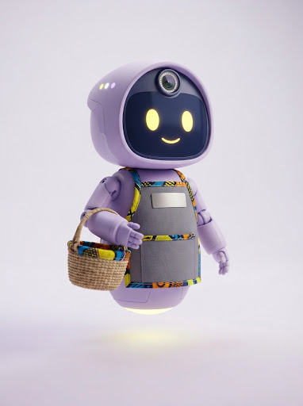

# MiKi — AI team for physical retail stores

MiKi is a premium responsive landing page for an AI team built for physical retail stores. The page presents MiKi as a personal store manager assistant supported by Security, Operations, and Customer Care agents.

## Landing-page preview

### Hero


The hero introduces MiKi with a calm editorial layout, existing-store CCTV imagery, a soft animated glow, a clear early-access CTA, and a responsive split composition.

### MiKi AI team




The AI-team section pairs the personal MiKi card with Security, Operations, and Customer Care modules. On mobile, the module cards use full-width media blocks, readable typography, contained artwork, and unified card surfaces so each image belongs to its card rather than appearing as a detached panel.

### What MiKi learns


MiKi learns each store’s rhythm through manager-controlled settings such as queue warnings, delivery checks, morning briefs, and preferred alert channels.

## Current experience

- Responsive editorial layout across mobile, tablet, and desktop breakpoints.
- Shrinking sticky header with smooth transitions after the hero section.
- Scroll-linked hero background parallax with scale and opacity depth treatment.
- Word-by-word narrative blur reveal tied to scroll position and reversible on upward scroll.
- Staggered post-hero AI-team card pop-up reveal.
- Dual-side FAQ slide-in with a short left-to-right cascade.
- Accessible FAQ accordion and interactive learned-store settings panel.
- Touch-safe mobile spacing with a premium split composition for hero and learned-store content.
- Mobile AI-team cards with full-width, readable image framing and color-matched surfaces.
- Reduced-motion safeguards and mobile parallax reset for smoother touch scrolling.

## Project history

1. **Reference implementation** — Recreated the supplied MiKi landing-page structure, copy, visual system, imagery, responsive breakpoints, and interaction patterns.
2. **Sticky navigation** — Added a scroll-triggered compact header that preserves the original hero state and transitions to a smaller blurred/shadowed state after the hero.
3. **Scroll reveals** — Added staggered word-bubble reveals for the AI-team cards and directional left/right slide-ins for the FAQ layout.
4. **Scrollytelling blur** — Added per-word blur and opacity progression to the hero and narrative paragraphs, including reverse-scroll behavior.
5. **Hero depth motion** — Added a lightweight requestAnimationFrame parallax controller for the hero background, with scale/fade limits and mobile/reduced-motion safeguards.
6. **Mobile refinement** — Introduced premium halfspace compositions for the hero and learned-store pair, then refined AI-team cards for clear full-width media and readable type on 375px and 320px screens.
7. **Unified card surfaces** — Matched Security, Operations, and Customer Care card colors to their embedded image backgrounds so the artwork reads as one continuous surface.

## Tech stack

- Semantic HTML
- Modern CSS with responsive media queries, CSS variables, and reduced-motion support
- Lightweight vanilla JavaScript
- WebGL hero canvas motion
- Vite for local development and production builds

## Run locally

```bash
pnpm install --frozen-lockfile
pnpm run dev
```

The development server listens on port `3000`.

Create a production build:

```bash
pnpm run build
```

## Validation

The latest landing page has been checked at mobile, tablet, and desktop viewport sizes. The responsive pass verified layout composition, sticky-header transitions, hero parallax, narrative blur reversal, AI-team card reveals, FAQ slide-in behavior, FAQ accordion interaction, mobile card framing, and horizontal-overflow safety.

## Repository structure

```text
.
├── index.html                 # Landing-page markup and copy
├── style.css                 # Design system, layout, responsive rules, motion states
├── app.js                    # Canvas motion and accessible interactions
├── public/assets/             # Supplied MiKi visual assets
├── public/manus-routes.json   # Managed preview route manifest
├── app.config.ts              # Project metadata
└── reference/                # Supplied design brief and source reference
```

## Brand

MiKi is designed for physical retail teams that need practical operational support without losing control of their people, footage, or decisions.
